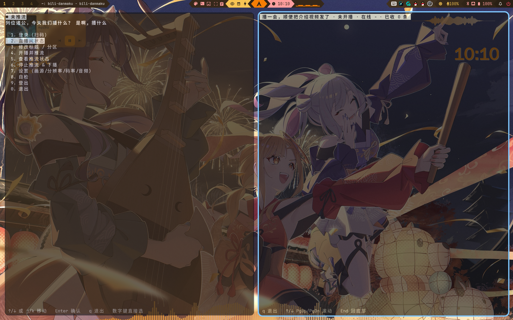

<h1>ZEK-blv & ZEK-danmaku</h1>

<p><strong>一个简单的b站直播工具（即将加入ZEK-niri）</strong><br />



<div align="center">

<sub>是啊，播什么</sub></p>

</div>

- **房间控制**（登录 / 状态 / 分区 / 改标题 / 开播拿推流码 / 下播）
- **画面推流**：在完成登录选择开播后工具会自动写入OBS配置一键开播，无需手动输入

## 依赖

| 组件 | 用途 |
|------|------|
| Python 3.8+（标准库 + `dbus`） | 主程序 |
| `obs-studio` | 屏幕采集 + 编码 + 推流 |
| `ffmpeg` | webcam / test 画源的编码推流 |
| `xdg-desktop-portal-gnome` | OBS 录屏后端 |
| `chafa`（可选） | 终端内显示登录二维码（kitty 下为高清像素图） |

Arch/CachyOS 可能需要安装：

```bash
sudo pacman -S --needed obs-studio ffmpeg \
    xdg-desktop-portal xdg-desktop-portal-gnome \
    python-dbus chafa
```

## 安装

```bash
cd ~/ZEK-blv          # 源码目录
./install.sh          # 命令位于 ~/.local/bin/ZEK-blv，依赖位于 ~/.local/share/ZEK-blv/
```

装完后：

```bash
ZEK-blv               # 启动（若提示找不到命令，把 ~/.local/bin 加入 PATH）
ZEK-blv --check       # 自检
ZEK-blv --version     # 版本
```
## 实时弹幕：ZEK-danmaku

独立工具，可以实时查看直播间弹幕

```bash
ZEK-danmaku                    # 看自己直播间的弹幕
ZEK-danmaku --room 6           # 看指定房间（支持短号，会自动解析成真实房号）
ZEK-danmaku --room 6 --plain   # 输出日志
```

全屏界面：顶部显示「房间名 · 直播状态 · 在线 · 已收条数」，下面是滚动弹幕，
按类型着色（普通弹幕白、礼物黄、醒目留言[SC]品红、进场/关注青、系统绿）。

按键：`q` 退出，`↑`/`↓` 单行滚动，`PgUp`/`PgDn` 翻页，`End` 回到底部自动跟随。

> 注意：弹幕多少取决于房间活跃度，人气不代表现在多少人在直播间里，所以如果你直播间没人看没弹幕不要怀疑推流问题，因为我也没流量（

## 用法

```bash
ZEK-blv               # 方向键 TUI：↑/↓ 选择，Enter 确认，q 退出（也支持数字键直接选）
ZEK-blv --check       # 自检（建议第一次先跑）
```

菜单：

```
登录（扫码）         ← ↑/↓ 移动高亮条，Enter 确认
直播间状态
修改标题 / 分区
开播并推流
查看推流状态
停止推流 & 下播
设置（画源/分辨率/码率/音频）
自检
登出
退出
```

操作键：`↑`/`↓` 或 `j`/`k` 移动，`Enter` 确认，`q` 退出，数字键 `1`~`0` 可直接打开选项。

**第一次开播流程（屏幕）：**

1. 选 `1` 登录，终端里显示二维码（kitty 下是高清图），用哔哩哔哩 App 扫码确认。
2. 选 `4` 开播。可选填标题 / 分区。**开播是公开动作**，工具会再确认一次。
3. 工具把 bilibili 的推流地址+密钥写进 OBS 当前 profile，然后启动
   `obs --startstreaming`。
4. OBS 弹出后，首次需要在它的「屏幕采集(PipeWire)」源里选一次屏幕（之后会记住）。
5. 选 `5` 看状态、`6` 停止并下播（会同时关闭 OBS 和下播）。

## 画源

在 `7 设置` 里切换：

- `screen`（默认）—— 用 **OBS** 采集整屏。采集哪个屏/窗口、分辨率、码率、编码器
  （默认 nvenc）都在 **OBS 里配**，本工具只负责把推流地址写进 OBS 并启动它。
- `webcam` —— 用 `/dev/video0` 摄像头（可改设备），ffmpeg 推流。
- `test` —— 推彩条测试画面 + 提示音，验证「登录→开播→推流」全链路是否通（走 ffmpeg）。

## 配置

配置文件 `~/.config/ZEK-blv/config.json`，用 `7 设置` 修改。

- `video.source`：`screen` / `webcam` / `test`。
- 屏幕推流的分辨率/码率/编码器在 OBS 里改（OBS 菜单 → 设置 → 输出/视频）。
- `webcam` / `test` 的码率、分辨率、编码器在本工具配置里改。

原脚本路径可设环境变量 `BILI_LIVE_STREAM_BIN`，或在设置菜单里指定；默认自动找
`~/下载/bilibili_live_stream` 和已安装的 `~/.local/share/ZEK-blv/bilibili_live_stream`

## 故障排查

| 现象 | 处理 |
|------|------|
| 找不到原脚本 | 放到 `~/下载/bilibili_live_stream`，或设 `BILI_LIVE_STREAM_BIN` |
| 开播提示 `auth` | 先 `1 登录` |
| 开播提示 `verify_required` / `face_auth_required` | 会给验证二维码，扫完再开 |
| OBS 已运行导致冲突 | 先关掉 OBS 再开播 |
| OBS 连上又被踢（send error 32） | 上次开播残留了失效推流码；工具会自动先下播再重开，若还不行手动 `6` 下播后重新 `4` 开播 |
| OBS 里没画面 | 在 OBS 的「屏幕采集(PipeWire)」源里重新选一次屏幕 |
| 改分区提示 `60024/60043` | 该分区要人脸认证 |
| 提示「操作太频繁」 | 等十几秒再试 |

## 安全提醒

- 推流码是敏感凭据，不要转发第三方。
- 凭据存 `~/.cache/bilibili-live-stream/credentials.json`（0600）。
- `开播` 会让直播间立刻公开并通知粉丝，工具会在执行前再次确认。

## 更多信息与主页
- QQ：`1846318834` QQ(备用): `3456599262` 
- [bilibili/Zer05ky凌空-ZEK](https://space.bilibili.com/575667990/upload/video) 我的b站主页
- [bilibili/Zer05ky](https://space.bilibili.com/1168962291?spm_id_from=333.1387.follow.user_card.click) 我的直播间
- [林长枫shorin709]（https://space.bilibili.com/9202840?spm_id_from=333.337.0.0）直播工具初始文件来源
- [KaguyaMao/Tsukuyomi](https://github.com/KaguyaMao/Tsukuyomi) 使用的agent
- bug与问题反馈群号: `1128905094`
- [sky1234762/ZEK-niri](https://github.com/sky1234762/ZEK-niri) 我的桌面配置包
